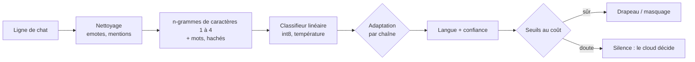
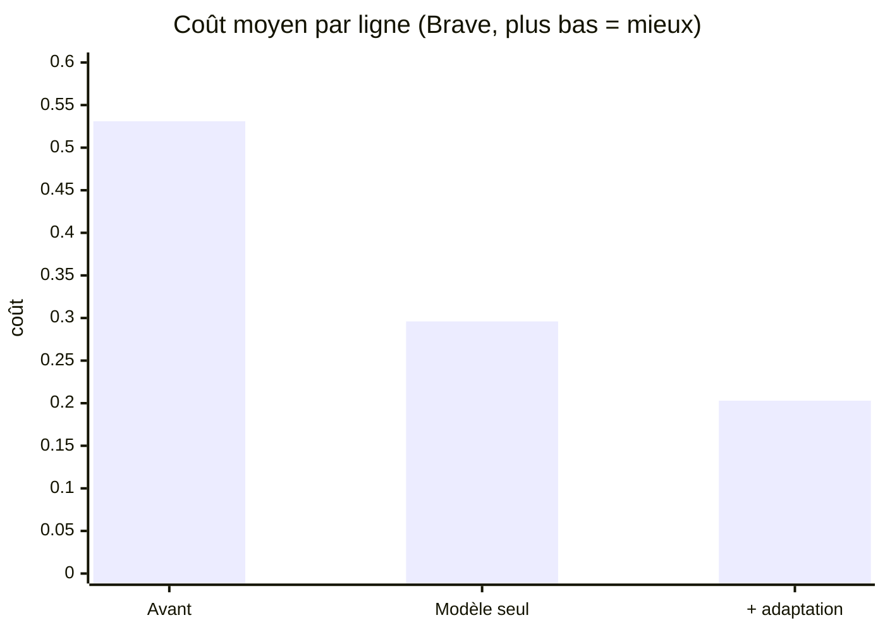

<!-- EBAUCHE : les blocs marques A VENIR attendent la fin de la collecte (E9) et la lecture unique de heldout. -->

UN PROJET DE RECHERCHE DE

### [Kick Chat Translator](https://github.com/kilworks/kick-chat-translator)

l'extension qui traduit le chat de Kick en direct, dans la langue de chaque spectateur

Ce dépôt documente comment l'extension va reconnaître la langue de chaque message. 
Le modèle étudié ici sera livré dans une prochaine version de Kick Chat Translator, une fois heldout lu.

---

# Détection de langue par inférence

**Un modèle entraîné, livré dans l'extension [Kick Chat Translator](https://github.com/kilworks/kick-chat-translator), qui devine la langue de chaque message du chat, chez l'utilisateur, sans service externe.**

**[Essayer la démo](https://kilworks.github.io/kct-detection-langue/)** · [Journal des expériences](journal.md) · [Dossier de revue](REVUE.md) · [Processus](PROCESSUS.md) · [Code](https://github.com/kilworks/kick-chat-translator/tree/feat/lid-inference)

---

## En bref

| | Avant (master) | Modèle seul | Modèle + adaptation par chaîne |
|---|:---:|:---:|:---:|
| **Coût moyen par ligne** (Brave, plus bas = mieux) | 0,531 | 0,296 | **0,203** |
| **Réponses justes / silences / fausses** sur 711 lignes de chat (Brave) | 445 / 145 / 121 | 564 / 124 / 23 | 598 / 102 / 11 |
| **Banc Tatoeba**, bonne langue trouvée | 82 % | 98 % | 98 % |

> Chiffres sur le jeu **dev** : ils ont servi à choisir le modèle, ils sont donc optimistes. Le jeu **heldout** (993 lignes) ne sera lu qu'une fois pour ce modèle, à la fin ; ses totaux ont déjà servi à mesurer le détecteur actuel.
>
> Intervalles à 95 % (bootstrap apparié sur les 232 couples fichier:chaîne de dev) : le gain sur `master` et celui de l'adaptation sont nets ; celui de l'auto-apprentissage ne l'est pas encore. Référence publique : fastText lid.176 à la même place fait 0,390 de coût moyen. Détail dans [REVUE.md](REVUE.md) §10 bis.

---

## Le problème

L'extension doit connaître la langue de chaque message **avant** de le traduire. Une erreur se paie de deux façons :

| Erreur | Ce que voit le lecteur | Coût |
|---|---|:---:|
| Message caché à tort | un message disparaît (« déjà dans ta langue ») | **10** |
| Mauvaise langue source envoyée au cloud | une traduction absurde ou le texte inchangé | **5** |
| Mauvais drapeau | une étiquette fausse à côté du message | **1** |
| Silence | le cloud détecte la langue seul | **0,5** |

Ces coûts ont été fixés **avant** toute mesure. Les seuils du modèle minimisent ce coût sous une contrainte stricte : **aucune hausse des messages cachés à tort, pour aucun lecteur et aucun navigateur.**

Le détecteur actuel (`franc-min` et des tables de mots) se trompe sur 17,7 % des phrases Tatoeba (`franc-min` seul : 24 %) et sur 17 % des lignes de chat réel annotées (121 sur 711).

---

## La méthode

| Étape | Choix |
|---|---|
| **Modèle** | linéaire sur n-grammes hachés dans 2^15 ou 2^16 cases (famille fastText), poids int8, 1,5 à 2,9 Mo (2 à 4 Mo encodés dans le paquet), p95 0,05 ms par ligne, TypeScript pur, aucune dépendance |
| **Entraînement** | Tatoeba (42 langues), augmenté vers le registre du chat : minuscules, sans ponctuation, fenêtres de 1 à 4 mots, sans accents, hindi et bengali romanisés |
| **Auto-apprentissage** | chat Kick et Twitch non étiqueté, pseudo-étiquettes sûres (p ≥ 0,9 et langue déclarée de la chaîne d'accord) |
| **Adaptation par chaîne** | l'extension compte les langues dont elle est sûre dans la chaîne en cours et ajuste ses probabilités, sans jamais voir la ligne jugée |
| **Évaluation** | 711 lignes Kick annotées (dev) + 993 gardées de côté (heldout), jamais publiées, seuls les agrégats le sont ; heldout est coupé ligne par ligne et partage les chaînes de dev |

---

## Résultats provisoires

### Coût moyen par ligne, par navigateur

| Chemin | Avant | Modèle seul | + adaptation |
|---|:---:|:---:|:---:|
| Sans détecteur du navigateur (Brave) | 0,531 | 0,296 | **0,203** |
| Chrome | 0,439 | 0,301 | **0,205** |
| Firefox | 0,424 | 0,320 | **0,222** |

Adaptation causale (seules les lignes de la chaîne antérieures à la ligne jugée comptent, comme en direct), k = 10.

- **Sans détecteur du navigateur**, les réponses fausses passent de 121 à 23 sur 711 lignes (base-b15, E3 ; 107 corrigées, 9 cassées, McNemar χ² = 81).
- **Adaptation par chaîne**, version causale (E6c), simulée sur les captures du 04/11 (515 couples fichier:chaîne ayant au moins une ligne sûre, médiane 22 lignes) : coût moyen des 3 chemins 0,306 → 0,210, langues sources fausses 15 → 11.

### Auto-apprentissage sur le chat collecté (E9)

> *A VENIR* : collecte en cours sur plusieurs machines (PC, serveur, VM), Kick et Twitch, 45 langues déclarées. Les modèles seront réentraînés sur la collecte complète, et le meilleur sera retenu sous la contrainte des messages cachés.

| Modèle | Pseudo-lignes | Coût seul | Coût adapté |
|---|:---:|:---:|:---:|
| accrom-b16 (référence) | 0 | 0,306 | 0,210 |
| Twitch seul (contrôle de fuite) | *A VENIR* | *A VENIR* | *A VENIR* |
| Kick filtré | *A VENIR* | *A VENIR* | *A VENIR* |
| Kick + Twitch | *A VENIR* | *A VENIR* | *A VENIR* |

### Lecture unique de heldout

> *A VENIR*

---

## Ce qui n'a pas marché

| Piste | Résultat | Pourquoi rejetée |
|---|---|---|
| Réseau de neurones (façon CLD3) | 98,3 % sur Tatoeba, coût chat 0,410 | se trompe plus souvent avec assurance |
| Fréquence globale des langues (EM de Saerens) | instable sur les langues rares | apprend les chaînes capturées, pas Kick |
| Premier banc | chiffre faux, corrigé | tournait sans modèle installé, une garde l'empêche maintenant |
| Adaptation par langue déclarée | 0,214 annoncé, corrigé | mélangeait plusieurs chaînes, pas ce que l'extension verrait |

Le détail de chaque expérience est dans [journal.md](journal.md).

---

## Suite

- [x] Modèle linéaire, seuils au coût, adaptation par chaîne simulée
- [ ] Collecte de chat à grande échelle et auto-apprentissage (E9) *en cours*
- [ ] Mesurer sur de vraies traductions si la langue source aide le cloud (le 0,5 du silence est une hypothèse)
- [ ] Porter l'adaptation par chaîne dans l'extension, puis lecture unique de heldout
- [ ] Gemini Nano (Chrome) en arbitre des lignes ambiguës, seulement s'il reste un écart chiffré

---

## Code et outils

- **Inférence** : [`src/content/lid/`](https://github.com/kilworks/kick-chat-translator/tree/feat/lid-inference/src/content/lid) de l'extension, branche `feat/lid-inference`.
- **Entraînement et bancs** : [`tools/lid/`](https://github.com/kilworks/kick-chat-translator/tree/feat/lid-inference/tools/lid) (numpy, Node).
- **Suivi de la collecte** : [tui-dash](https://github.com/kilworks/tui-dash), tableau de bord en console publié à part.

## Licences

- Textes et page de ce dépôt : MIT.
- Phrases d'exemple et poids du modèle (`docs/model.b64`) : dérivés de [Tatoeba](https://tatoeba.org), CC BY 2.0 FR, merci à ses contributeurs.
